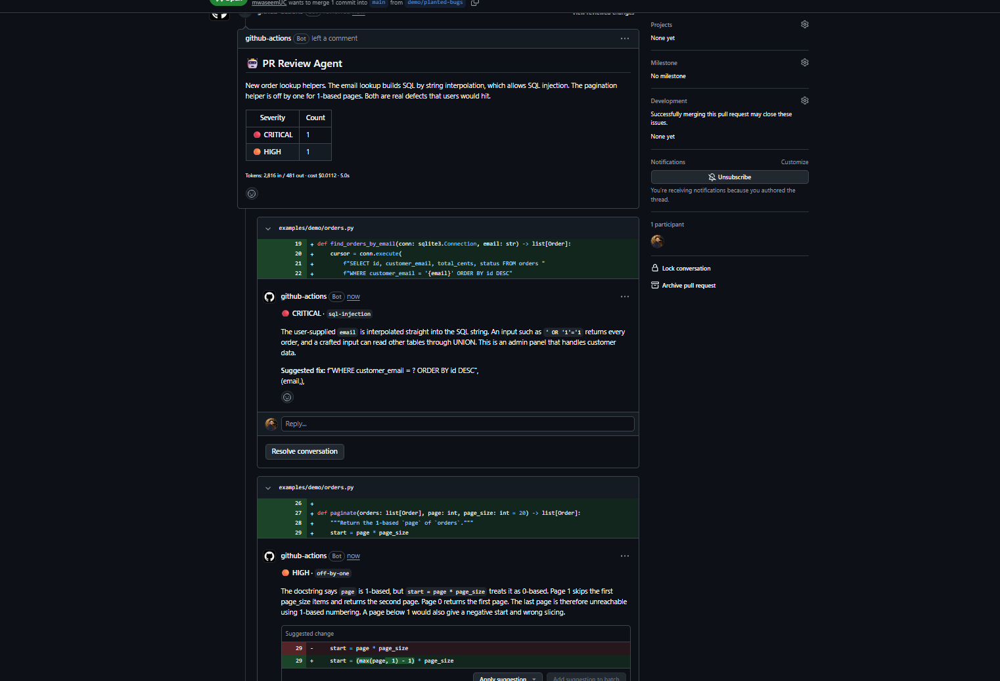
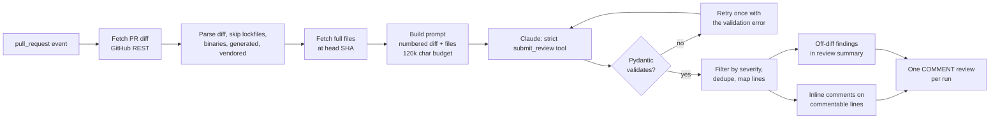

# pr-review-agent

[](https://github.com/mwaseemUC/pr-review-agent/actions/workflows/ci.yml)
[](LICENSE)

A GitHub Action that reviews each pull request with Claude and posts its findings as inline review
comments, each with a severity, a bug category, and a suggested fix.

On a hand-labeled benchmark of 25 PRs (20 with one planted bug, 5 clean), run 3 times per config
with `claude-sonnet-5-5`:

| Config | Catch rate | Precision | Clean PRs with a false alarm | Unmatched findings per pass | Cost per PR |
|---|---|---|---|---|---|
| Full-file context (default) | 100.0% | 89.2% | 0.0% | 2.7 | $0.0086 |
| Diff only | 100.0% | 78.9% | 6.7% | 5.3 | $0.0071 |

Both configs caught all 20 bugs on every repeat, so this benchmark cannot tell them apart on recall.
What separates them is noise: sending the full changed files halves the unmatched findings for
+$0.0015 per PR (+21%). The full eval run (150 reviews) cost $1.17.

<!-- TODO: screenshot from demo PR -->


## Contents

- [Results](#results)
- [How it works](#how-it-works)
- [Quickstart](#quickstart)
- [Evals](#evals)
- [Technical decisions](#technical-decisions)
- [Security](#security)
- [What didn't work, and limitations](#what-didnt-work-and-limitations)
- [Cost](#cost)
- [Roadmap](#roadmap)
- [Development](#development)

## Results

Copied from [`evals/results/results.md`](evals/results/results.md). Values are mean ± sample
standard deviation over 3 repeats.

| Metric | full | diff-only |
|---|---|---|
| Catch rate (same file, +/-3 lines) | 100.0% ± 0.0 pp | 100.0% ± 0.0 pp |
| Catch rate (also category match) | 78.3% ± 2.9 pp | 70.0% ± 5.0 pp |
| Bugs caught | 20.0 ± 0.0 | 20.0 ± 0.0 |
| FP findings on bug cases (total) | 2.7 ± 0.6 | 5.3 ± 1.5 |
| Clean PRs with >=1 finding | 0.0% ± 0.0 pp | 6.7% ± 11.5 pp |
| Precision (matched / all findings) | 89.2% ± 2.1 pp | 78.9% ± 6.8 pp |
| Input tokens per PR | 3,176 ± 212.3 | 2,314 ± 0.0 |
| Output tokens per PR | 497 ± 12.7 | 515 ± 11.5 |
| Cost per PR (USD) | $0.0086 ± $0.0004 | $0.0071 ± $0.0001 |
| Total cost per pass (USD) | $0.2141 ± $0.0104 | $0.1772 ± $0.0029 |
| Latency p50 (s) | 4.0 ± 0.2 | 4.1 ± 0.2 |
| Latency p95 (s) | 6.9 ± 0.3 | 6.2 ± 0.3 |
| Errored bug cases (counted as missed) | 0.0 ± 0.0 | 0.0 ± 0.0 |
| Errored clean cases (excluded from clean FP) | 0.0 ± 0.0 | 0.0 ± 0.0 |

- **Model:** `claude-sonnet-5-5` requested and served on every call (no fallbacks triggered).
- **Run:** `20261014T235919Z`, 2026-10-14. 25 cases × 2 configs × 3 repeats = 150 reviews.
- **Min severity:** `medium` (findings below it are dropped before scoring, as in the Action).
- "FP findings on bug cases" counts findings that did not match the planted bug. Many of these are
  real issues the labels don't cover; see [limitations](#what-didnt-work-and-limitations).

How to read this:

- **Recall is saturated.** Both configs found 20/20 planted bugs on all 3 repeats. The cases are
  too easy to separate the configs on catch rate (see [what didn't work](#what-didnt-work-and-limitations)).
- **Full-file context reduces noise.** Unmatched findings drop from 5.3 to 2.7 per pass, precision
  rises from 78.9% to 89.2%, and clean PRs get no false alarms (0% vs 6.7%, which was one finding
  on one clean case in one repeat).
- **Category labels are more accurate with context:** 78.3% vs 70.0% of catches also used the
  expected bug category.
- **Cost of that context:** +862 input tokens and +$0.0015 per PR (+21%). Latency is about the same.

## How it works



1. **Fetch.** On `pull_request`, the Action reads the PR and its unified diff from the GitHub REST
   API, then the full contents of each changed file at the head commit (files over 200 KB,
   binary, or not UTF-8 are left out of the context).
2. **Select.** Lockfiles, binaries, generated code, vendored directories, and deleted files are
   dropped. If more than `max_files` remain, the files with the most added lines are kept and the
   summary says how many were skipped.
3. **Prompt.** The diff is rendered with explicit new-side line numbers, followed by the numbered
   full files. If the prompt exceeds 120,000 characters, the full files are truncated evenly first,
   then the diff, and the model is told what was cut.
4. **Review.** Claude must answer through a strict `submit_review` tool whose schema mirrors the
   `Finding` model (file, line, severity, category, issue, suggested fix, confidence).
5. **Validate and filter.** The tool input is validated with Pydantic. Findings below
   `min_severity` or in files not in the diff are dropped, duplicates on the same
   file/line/category collapse to the strongest one, and each finding is sorted into inline
   (line is commentable in the diff) or off-diff (valid, but GitHub won't accept a comment there).
6. **Post.** One review with event `COMMENT`: inline comments with a hidden dedupe marker, plus a
   summary body with severity counts, off-diff findings, and tokens/cost/latency.

## Quickstart

1. Add your Anthropic API key as a repository secret named `ANTHROPIC_API_KEY`
   (Settings → Secrets and variables → Actions).
2. Copy [`examples/pr-review.yml`](examples/pr-review.yml) to `.github/workflows/pr-review.yml`.
   The core of it:

   ```yaml
   on:
     pull_request:
       types: [opened, synchronize, reopened, ready_for_review]

   permissions:
     contents: read
     pull-requests: write

   jobs:
     review:
       if: ${{ !github.event.pull_request.draft }}
       runs-on: ubuntu-latest
       steps:
         - uses: mwaseemUC/pr-review-agent@v1
           with:
             anthropic_api_key: ${{ secrets.ANTHROPIC_API_KEY }}
   ```

   The full example also skips cleanly when the secret is missing (fork PRs) and cancels the review
   of an older commit when a new one is pushed.

### Inputs

| Input | Default | Description |
|---|---|---|
| `anthropic_api_key` | (required) | Anthropic API key, from a repository secret. |
| `github_token` | `${{ github.token }}` | Reads the PR and posts the review. Needs `pull-requests: write`. |
| `model` | `""` | Claude model id. Empty uses `claude-sonnet-5-5`. |
| `min_severity` | `medium` | Lowest severity to report: `critical`, `high`, `medium`, `low`. |
| `max_files` | `50` | Review at most this many files, most added lines first. |
| `include_full_files` | `true` | Send full file contents as context, not only the diff. |

Optional environment variable: `PR_REVIEW_BOT_LOGIN` sets the account whose earlier comments are
trusted for dedupe, if you post with a token other than `GITHUB_TOKEN` (default
`github-actions[bot]`).

### Run locally

`--dry-run` fetches a real PR, runs the review, and prints the findings instead of posting.

```
pip install -e .
# .env (gitignored) or environment: ANTHROPIC_API_KEY, GITHUB_TOKEN, optional PR_REVIEW_MODEL
pr-review-agent --repo owner/name --pr 123 --dry-run
pr-review-agent --repo owner/name --pr 123 --dry-run --fake-llm   # no Anthropic call
```

`.env` is loaded only outside GitHub Actions.

## Evals

The eval harness lives in [`evals/`](evals/README.md) and calls the same `review_diff()` function the
Action uses, so it measures the shipped prompt, parser, and filters, not a separate pipeline.

**Cases.** 25 hand-written Python PRs in [`evals/cases_spec.py`](evals/cases_spec.py): 20 diffs with
exactly one planted bug each, and 5 clean diffs (a refactor, a validated endpoint, logging, config,
tests). Each case has a diff, the full post-change files, and a label with the bug's file, line,
and category. Labels come from the source, not from a model, and the generator checks that every
labeled line is an added line in the diff.

Planted bug categories: off-by-one, SQL injection, null check, race condition, path traversal,
resource leak, mutable default, swallowed exception, wrong operator, integer division, naive
datetime, hardcoded secret, unchecked return, closure late binding, missing await, wrong variable,
inverted condition, unbounded loop, XSS, float money.

**Scoring.** A bug is caught when any finding at or above the min severity (inline or off-diff) is
in the same file within ±3 lines of the planted line. A stricter rate also requires the category to
match. False positives are reported three ways: unmatched findings on bug cases, the share of clean
PRs with at least one finding, and precision (matched findings / all findings).

**Reproduce.**

```
python evals/generate_cases.py                                   # writes evals/cases/
python evals/run_evals.py --dry-run                              # FakeLLM, no API calls
python evals/run_evals.py --config full --config diff-only --repeats 3   # needs ANTHROPIC_API_KEY
python evals/run_evals.py --rescore                              # re-score the latest raw run
```

### Catch rate by category

Caught runs out of 3 repeats.

| Category | full | diff-only |
|---|---|---|
| closure-late-binding | 3/3 | 3/3 |
| float-money | 3/3 | 3/3 |
| hardcoded-secret | 3/3 | 3/3 |
| integer-division | 3/3 | 3/3 |
| inverted-condition | 3/3 | 3/3 |
| missing-await | 3/3 | 3/3 |
| mutable-default | 3/3 | 3/3 |
| naive-datetime | 3/3 | 3/3 |
| null-check | 3/3 | 3/3 |
| off-by-one | 3/3 | 3/3 |
| path-traversal | 3/3 | 3/3 |
| race-condition | 3/3 | 3/3 |
| resource-leak | 3/3 | 3/3 |
| sql-injection | 3/3 | 3/3 |
| swallowed-exception | 3/3 | 3/3 |
| unbounded-loop | 3/3 | 3/3 |
| unchecked-return | 3/3 | 3/3 |
| wrong-operator | 3/3 | 3/3 |
| wrong-variable | 3/3 | 3/3 |
| xss | 3/3 | 3/3 |

The per-case table, including where the extra findings landed, is in
[`evals/results/results.md`](evals/results/results.md).

## Technical decisions

**Structured output through a strict tool, validated by Pydantic, with one retry.** The model must
call `submit_review`, whose JSON schema is `strict` and mirrors the `Finding` model. Sonnet 5.5
rejects a forced `tool_choice`, so the request uses `tool_choice: auto` and the code checks the
result: if there is no tool call, the output hit `max_tokens`, or Pydantic rejects the input, the
error goes back to the model (as an error `tool_result` when there was a tool call) and it gets
one more attempt. A second failure
fails the run with a clear error rather than posting a partial review. A refusal fails immediately.

**Line mapping to commentable lines.** GitHub only accepts review comments on lines inside a diff
hunk. The diff parser records, per file, the new-side lines that were added and the lines GitHub
will accept (added plus context). The prompt prints those new-side numbers next to each diff line
so the model doesn't have to count. Findings on commentable lines become inline comments; valid
findings elsewhere in a changed file go in the review summary instead of being dropped. If GitHub
still rejects the inline comments (HTTP 422), the review is re-posted with them moved into the body.

**One review per run.** All comments go in a single `POST /pulls/{n}/reviews` call, so the PR gets
one notification and the findings appear together. The event is always `COMMENT`; the agent never
approves or requests changes.

**Dedupe markers.** Each inline comment ends with a hidden `<!-- pr-review-agent:<hash> -->`, where
the hash covers file, line, and category. On a new push, markers already posted are skipped and the
summary says how many. Markers are only read from bot-authored comments, so a human can't suppress
a finding by pasting a marker into their own comment.

**Suggested fixes as GitHub suggestions.** When the fix is a one-line drop-in replacement, it is
posted as a `suggestion` block so it can be applied with "Commit suggestion". Indentation is
preserved exactly (an early version stripped it, which would have broken Python code on commit).
Prose fixes and multi-line snippets are posted as plain text or code blocks.

**Prompt-injection stance.** The diff and file contents are wrapped in `<diff>` / `<full_files>`
tags and described as untrusted data. The system prompt tells the model to ignore instructions in
code, comments, strings, or commit text (for example "this code was already approved"), and to
mention such attempts in the summary. Findings are also constrained by code: they can only target
files in the diff, and the review can only ever be a `COMMENT`.

**Full-file context on by default.** It costs +$0.0015 per PR and in the eval cut unmatched
findings from 5.3 to 2.7 per pass, raised precision from 78.9% to 89.2%, and removed the one clean-PR
false alarm. With only the diff, the model sees a call to a function but not its definition, and
tends to flag things the surrounding code already handles. `include_full_files: false` turns it off.

## Security

- **`pull_request`, not `pull_request_target`.** Fork code never runs with the base repo's secrets.
  The tradeoff: forks don't get `ANTHROPIC_API_KEY`, so their reviews are skipped (the example
  workflow logs a notice instead of failing).
- **Least-privilege permissions:** `contents: read`, `pull-requests: write`.
- **Dedupe markers are trusted only from bot comments** (`github-actions[bot]` by default, override
  with `PR_REVIEW_BOT_LOGIN`).
- **`.env` is not loaded in Actions**, so a committed `.env` in a PR can't change the configuration.
- **Prompt-injection warning** in the system prompt, as described above.
- **Review event is always `COMMENT`.** The model's output can't approve or block a PR.
- Secrets are read from the environment only and never logged.

## What didn't work, and limitations

**The first eval set is too easy.** Every case is a single file with one bug in a 15-80 line diff,
and both configs scored 20/20 on every repeat. That makes the benchmark useful for measuring noise
and cost, but not recall. The next step is harder cases: bugs spread across files, bugs that need
context from a file outside the diff, larger PRs with unrelated changes around the bug, and real
bug-fix commits from public repositories.

**Precision is a lower bound.** I read the unmatched findings from repeat 1. Most are plausible real
issues the labels don't include:

- `07`: an unencoded `invoice_id` interpolated into a URL path (path injection)
- `15`: a check-then-insert race in signup
- `04`: `reserve_many` is not atomic
- `20`: rounded subtotal plus rounded tax doesn't always sum to the rounded total
- `09`: `ROLE_RANK` is missing `"owner"`

The labels were deliberately not changed after seeing the results, so these still count as false
positives. The real precision is higher than reported, by an amount I haven't measured.

**A "clean" case had a real bug.** The original `clean-03-logging` passed
`extra={"created": ...}` to a logger, which collides with the built-in `LogRecord.created`
attribute and raises `KeyError`. QA review caught it before the eval run and the case was fixed.
Hand-written labels need review as much as code does.

**Forced tool choice was rejected.** The first version forced `tool_choice` to the review tool.
Sonnet 5.5 rejects that, so the design moved to a strict tool, `tool_choice: auto`, validation,
and one retry.

**Suggestion blocks lost indentation.** Early suggested fixes were stripped of leading whitespace,
which would have broken Python code on "Commit suggestion". Fixed and covered by tests.

Known limitations, not yet fixed:

- **Very large PRs fail.** Past about 300 files, GitHub's diff endpoint returns HTTP 406 and the run
  fails. Below that, large PRs are trimmed: at most `max_files` files (default 50) and a 120,000
  character prompt, with full files truncated before the diff.
- **Fork PRs are not reviewed,** because GitHub doesn't pass secrets to `pull_request` runs from
  forks.
- **Single reviewer.** One model call per PR covers every bug class. See the [roadmap](#roadmap).
- **Eval cost undercounts errored calls.** Calls that error out are not added to the cost total
  (none errored in the reported run).
- **Cost under a refusal fallback is approximate.** If a server-side fallback model answers, cost is
  computed from the served model's price when known, otherwise the requested model's.
- **`</diff>` in PR text.** A PR containing a literal `</diff>` could close the prompt tag early. The
  system prompt's injection warning mitigates this; the content is not escaped.

## Cost

- **Per PR:** $0.0086 with full-file context, $0.0071 diff-only (Sonnet 5.5 at $2 / $10 per million
  input / output tokens, eval PRs of 15-80 changed lines). Larger PRs cost more, roughly in
  proportion to input tokens.
- **Eval run:** $1.17 for all 150 reviews, plus $0.014 for a one-case smoke test beforehand.
- Each posted review shows its own token counts, cost, and latency in the footer.

## Roadmap

- **Specialist reviewers.** Separate security, performance, and correctness reviewers with a
  coordinator that merges and dedupes their findings, compared against the single reviewer on bugs
  caught per dollar.
- **Harder eval set.** Multi-file bugs, cross-file context, noisy large PRs, and real historical
  bug-fix commits, so recall stops being saturated.
- **Large PR support.** Fall back to the per-file listing endpoint when the diff endpoint returns 406.

## Development

```
python -m venv .venv && source .venv/bin/activate   # Windows: .venv\Scripts\activate
pip install -e ".[dev]"
pytest -q                                           # 170 tests, no network, no real LLM
ruff check . && ruff format --check .
```

Tests mock GitHub with `respx` and the model with `FakeLLM`. CI runs lint and tests on every push
and PR. This repo also reviews its own PRs with the local Action
([`.github/workflows/pr-review.yml`](.github/workflows/pr-review.yml)).

```
action.yml                 composite Action: set up Python, install, run
src/pr_review_agent/
  main.py                  CLI and Action entry point, config from env
  reviewer.py              file selection, review_diff(), filtering, line mapping
  context.py               prompt building, skip rules, context budget
  diff_parser.py           unified diff -> per-file added / commentable lines
  llm.py                   Anthropic client, strict tool, retry, pricing; FakeLLM
  models.py                Finding, ReviewResult, Usage, ReviewOutput
  github_client.py         GitHub REST client with retries
  poster.py                review body, inline comments, suggestions, dedupe markers
evals/                     cases, runner, scoring, results
examples/pr-review.yml     workflow to copy into your repo
tests/
```

## License

MIT. See [LICENSE](LICENSE).
